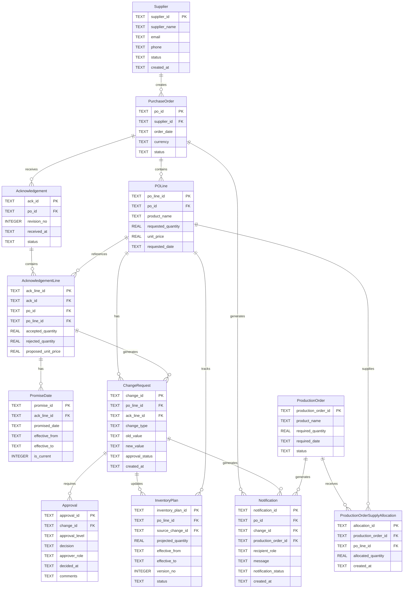

# Supplier Acknowledgement System
# Entity Relationship Diagram (ER Diagram)

## 1. Database Relationships

## 2. Relationship Explanation

1. Supplier to PurchaseOrder: One supplier can have multiple purchase orders.
2. PurchaseOrder to POLine: One purchase order can contain multiple products.
3. PurchaseOrder to Acknowledgement: One purchase order can receive multiple acknowledgements.
4. Acknowledgement to AcknowledgementLine: One acknowledgement can contain multiple lines.
5. AcknowledgementLine to PromiseDate: One acknowledgement line can have multiple promise-date records.
6. POLine to ChangeRequest: One purchase order line can have multiple change requests.
7. ChangeRequest to Approval: One change request can have multiple approval records.
8. ChangeRequest to InventoryPlan: A change can create multiple inventory plan versions.
9. ProductionOrder and POLine connect through ProductionOrderSupplyAllocation.
10. Notification connects purchase orders, changes and production orders with recipient roles.

## 3. Conclusion

The ER Diagram explains how all 12 database tables are connected using primary keys and foreign keys.

It provides a visual understanding of the Supplier Acknowledgement System database architecture.
